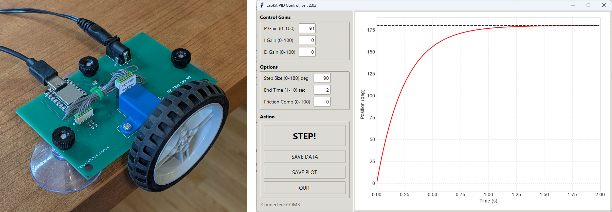

# Lab Kit Hardware

## What's in the kit

1. Board with motor and microcontroller
2. USB cable (USB-C to USB-A)
3. Power supply (9V)
4. Inertia wheel

For setup steps, see "Setting Up the Hardware" in the [User Guide](https://docs.google.com/document/d/1oedQPF3KCfcU4NCRRZGlrVdvtryyQlVAax1uANhdr_o/preview).

## How the hardware works

The board holds a small DC gearmotor that drives the inertia wheel. An encoder on the motor measures the wheel's position (1400 counts per revolution, about 0.26° per count). A Seeed Studio XIAO SAMD21 microcontroller reads the encoder and drives the motor through a motor driver chip.

When you click **STEP!** in the application, the application sends your PID gains and step size to the board over USB. The microcontroller then runs the PID control loop itself, updating the motor command every 10 ms. When the step is finished, it sends the position data back to your laptop for plotting.

| Item | Details |
|---|---|
| Microcontroller | Seeed Studio XIAO SAMD21 |
| Motor | N20 6V, 1:50, 300 rpm DC gearmotor with 7 cpr encoder |
| Motor driver | DRV8837 |
| Encoder | 1400 counts per inertia wheel revolution |
| Control loop rate | 100 Hz (every 10 ms) |
| Power | 9V external supply |

## How the kit is built

- [Bill of materials](https://docs.google.com/spreadsheets/d/1eiY56MtCPpFVDx8SDDJ77NbP-44Yh7Efw1C6tmSf-RA/edit?usp=sharing)
- [Manufacturing instructions](https://docs.google.com/document/d/1qRnnL5ahWP_KJW23SPV0DifVXHfY3aAhU3RXacXF7uY/edit?usp=sharing)
- [Arduino code that runs on the board](../Board_Software)
