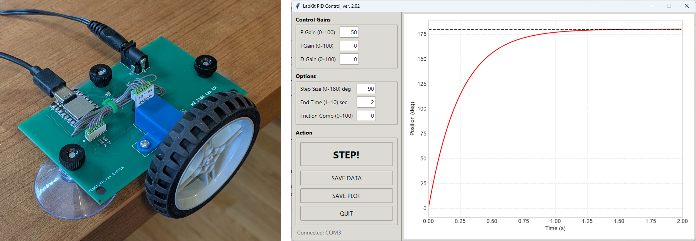

# ME 3281 Lab Kit

The ME 3281 Lab Kit lets you explore motor control systems at home, on your own schedule. The kit consists of a small hardware unit (a DC motor driving an inertia wheel) and an application you run on your laptop to set PID gains, run step responses, and save the results.

This site has everything you need to use the kit: the software to download, a description of the hardware, video tutorials, and other resources. Homework assignments are not posted here. Get those from your course instructor.

## Start here: the User Guide

### **[ME 3281 Lab Kit User Guide](https://docs.google.com/document/d/1oedQPF3KCfcU4NCRRZGlrVdvtryyQlVAax1uANhdr_o/preview)**

The User Guide walks you through installing the software, setting up the hardware, using the application, and troubleshooting. Read it before you start to use your lab kit.

## What's on this site

| Folder | What's in it |
|---|---|
| [Software](Software) | The lab kit application software that runs on your laptop |
| [Hardware](Hardware) | What's in the kit and how the hardware works |
| [Videos](Videos) | Video tutorials (coming soon) |
| [Board_Software](Board_Software) | The Arduino code that runs on the board (for the curious student) |

Click a folder name to open it. Each folder has a description that appears below its list of files.

## Downloading the software

Use the download links in the User Guide or on the [Software](Software) page.

Do not use the green **Code** button at the top of this page. It downloads a zip file of the source files, not the application.

## Getting help

See "Getting Help" in the User Guide.
